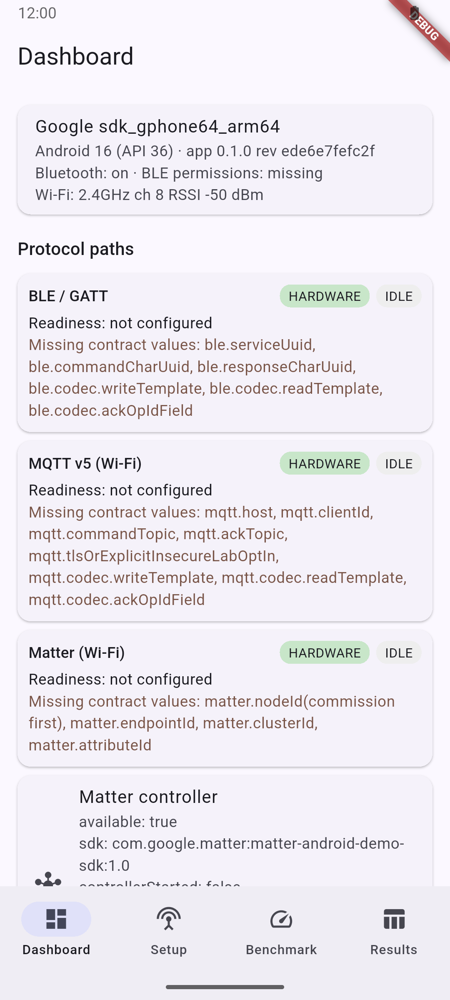
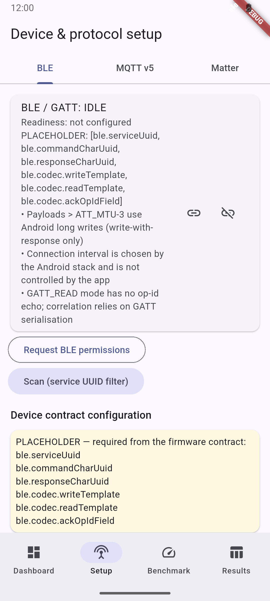
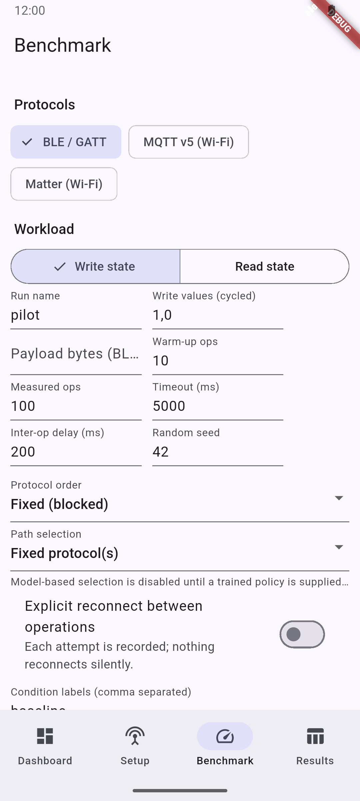

# IoT Conn Bench — Android connectivity abstraction and benchmark app

MS Software Engineering thesis prototype. Android app (Flutter UI + native Kotlin research core)
that benchmarks phone-to-ESP32 connectivity over **BLE/GATT**, **MQTT 5.0 over Wi-Fi** and
**Matter over Wi-Fi** through one common adapter contract, with a native benchmark engine,
local SQLite persistence, and versioned CSV/JSON export.

It is a research instrument: every number comes from the Kotlin core using
`SystemClock.elapsedRealtimeNanos()`, failures and timeouts are recorded, raw per-operation data is
kept, and nothing is simulated in the app (test doubles exist only in unit tests and are labelled
`SIMULATED`).

## Current status (2026-11-23)

| Area | Status |
|---|---|
| Kotlin research core (domain, runner, metrics, export, selection) | Implemented; **39/39 JVM unit tests pass** |
| Export recomputation (`tools/analysis/recompute_metrics.py`) | Verified on a SIMULATED sample export |
| BLE/GATT, MQTT v5 (HiveMQ 1.3.7), Matter (connectedhomeip demo SDK) adapters | Implemented; **compile with Matter enabled** (debug APK) |
| Flutter UI (dashboard, setup, benchmark, results) | Implemented; runs on emulator (screenshots below); `flutter analyze`/`flutter test` not yet run |
| Android build | **Debug APK builds with Matter enabled**; installs and launches on the Android 16 (API 36) emulator |
| Hardware acceptance (phone + ESP32) | **Not tested** — needs firmware contract values |

See `docs/ACCEPTANCE_REPORT.md` for the PASS / FAIL / NOT TESTED checklist and the researcher actions still required.

## Screenshots

Debug build on the Android emulator (Pixel "Medium Phone", Android 16 / API 36), before any firmware
contract is entered — every path correctly reports *not configured* and lists the missing values.

| Dashboard | Device & protocol setup | Benchmark configuration |
|---|---|---|
|  |  |  |

## Quick start (macOS, existing Flutter 3.44.6 toolchain)

```bash
cd ~/development/iot_conn_bench
~/development/flutter/bin/flutter pub get
~/development/flutter/bin/flutter run            # phone connected with USB debugging
# or
~/development/flutter/bin/flutter build apk --debug && adb install -r build/app/outputs/flutter-apk/app-debug.apk
```

All automated checks with logs: `bash tools/verify.sh` (writes `build_logs/`).

Build without the Matter SDK (only if the Matter AAR blocks the build; Matter then reports
UNAVAILABLE): `flutter build apk --debug --android-project-arg=enableMatter=false`, or set
`enableMatter=false` in `android/gradle.properties`.

## Using it

1. **Setup**: request BLE permissions; enter the firmware contract for each path (empty values are
   shown as PLACEHOLDER — see `docs/DEVICE_CONTRACT.md`); scan/select BLE device; store MQTT password
   if any; commission the Matter node from the phone; Connect.
2. **Dashboard**: start a session with board/firmware/router/broker metadata.
3. **Benchmark**: configure workload, warm-up, iterations, timeout, delay, order, labels → Start.
4. **Results**: per-protocol summaries, raw records, comparison (with compatibility warnings),
   export CSV + JSON.

## Repository map

```text
lib/                      Flutter UI (api/, screens/, widgets/)
android/app/src/main/kotlin/com/thesis/iotconnbench/
  core/                   platform-independent research core (JVM-testable)
    domain/ contract/ bench/ select/ metrics/ export/ mapping/ util/
  platform/               Android: ble/, mqtt/, matter/ (contract), persistence/, bridge/
android/app/src/matter/   real Matter controller adapter (connectedhomeip CHIPController)
android/app/src/noMatter/ fallback that only reports UNAVAILABLE (enableMatter=false)
android/app/src/test/     core unit tests + SIMULATED FakeAdapter
test/                     Flutter tests
tools/verify.sh           run all checks → build_logs/
tools/analysis/           recompute_metrics.py (independent recomputation of summaries)
docs/                     architecture, contract, broker, Matter, experiments, schema, testing, acceptance
```

## Documentation

- `docs/ARCHITECTURE.md` — diagram, layering, timing path, bridge contract, decisions
- `docs/DEVICE_CONTRACT.md` — values required from the ESP32 firmware, codec templates, semantics
- `docs/MQTT_BROKER.md` — Mosquitto (MQTT 5) setup and how to prove v5 negotiation
- `docs/MATTER.md` — controller feasibility audit, commissioning guide, limitations
- `docs/EXPERIMENTS.md` — running sessions, impairments, multipath rules
- `docs/EXPORT_SCHEMA.md` — CSV/JSON schema v1.0.0, statistics definitions
- `docs/TESTING.md` — test layers and hardware acceptance procedure
- `docs/DEPENDENCIES.md` — versions, rationale, permissions
- `docs/ACCEPTANCE_REPORT.md` — acceptance checklist (PASS / FAIL / NOT TESTED) and open items
