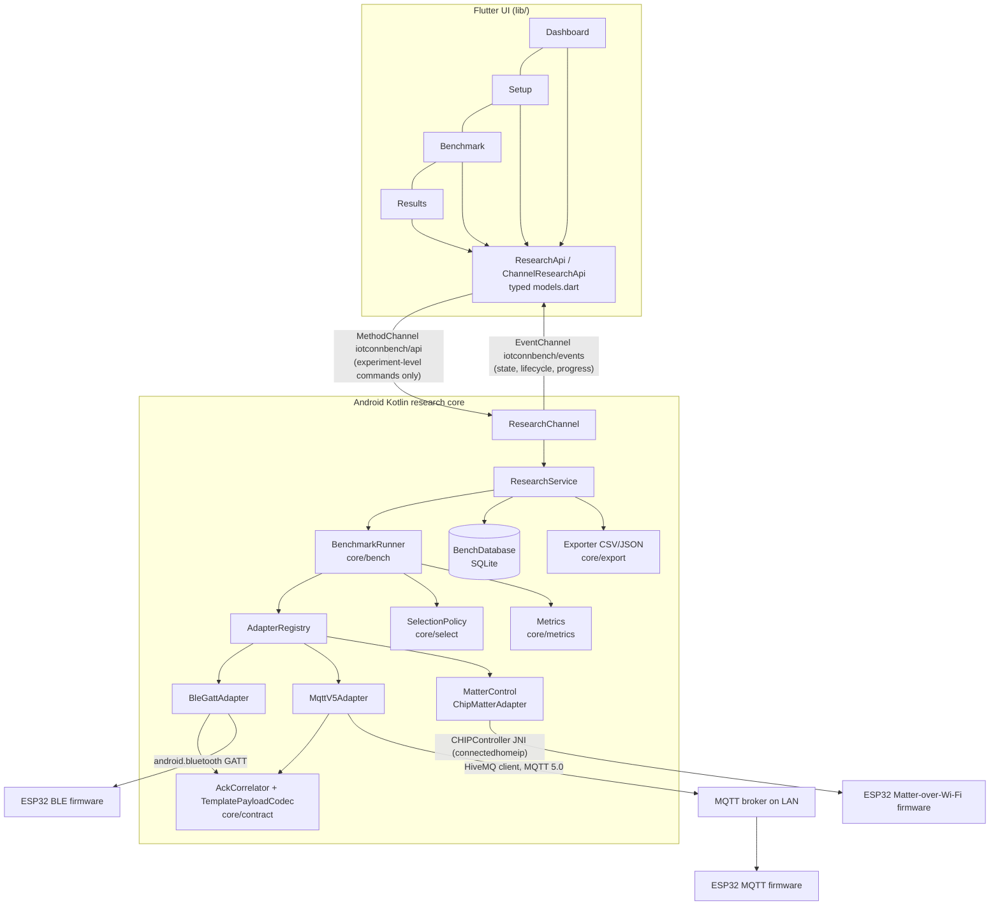

# Architecture

## Overview



Plain-text version:

```text
Flutter UI ── typed ResearchApi ── MethodChannel (commands) / EventChannel (events)
                                         │
Android Kotlin core:  ResearchChannel → ResearchService ─┬─ BenchmarkRunner ─ AdapterRegistry ─┬─ BleGattAdapter ─ Android GATT ─ ESP32
                                                          │      │  SelectionPolicy              ├─ MqttV5Adapter ─ HiveMQ ─ broker ─ ESP32
                                                          │      └  Metrics                      └─ ChipMatterAdapter ─ CHIP JNI ─ ESP32
                                                          ├─ BenchDatabase (SQLite: sessions, runs, operations, events)
                                                          └─ Exporter (CSV per operation, JSON metadata, summary.txt) → SAF folder
```

## Layering

| Layer | Package | Android imports | Tested on |
|---|---|---|---|
| Domain model, adapter contract, configs | `core/domain` | none | JVM (kotlinc 2.3.20) |
| Payload codec, ack correlation | `core/contract` | none | JVM |
| Runner, schedule, records, sink | `core/bench` | none | JVM |
| Selection policies | `core/select` | none | JVM |
| Metrics, comparability | `core/metrics` | none | JVM |
| Export | `core/export` | none | JVM + Python recomputation |
| Map ↔ typed mapping | `core/mapping` | none | JVM |
| Adapters | `platform/ble`, `platform/mqtt`, `platform/matter` | yes | build + hardware |
| Persistence | `platform/persistence` | yes | build + hardware |
| Bridge + service | `platform/bridge` | yes | build |

The runner depends only on `ConnectivityAdapter` (spec §4.2). Test doubles (`FakeAdapter`) live in
`android/app/src/test` and are never packaged into the APK.

## Timing path (spec §3.2, §6.1)

1. Flutter sends **one** `startRun(config)` call.
2. `BenchmarkRunner` (Kotlin, `Dispatchers.Default`) walks the schedule and calls `adapter.execute()`.
3. The adapter takes `t_start = SystemClock.elapsedRealtimeNanos()` immediately before handing the
   request to the stack (`writeCharacteristic`, `publishWith().send()`, `OnOffCluster.on/off/read`).
4. The device-level response callback takes `t_end` from the same clock as its **first statement**
   (before decoding). For BLE/MQTT this is the correlated application acknowledgement; for Matter
   the InvokeResponse / ReadResponse from the device data model.
5. The record is written to SQLite, then progress is posted to Flutter. Nothing on the timed path
   crosses the platform channel.

Link-layer / broker acknowledgements are kept as diagnostics only (`ble.gatt_write_cb_ns`,
`mqtt.broker_ack_ns`), never as completion.

## Platform channel contract

Method names (Dart `ChannelResearchApi` ↔ Kotlin `ResearchChannel`): `getStatus`, `getConfig`,
`saveConfig`, `setSecret`, `requestBlePermissions`, `discover`, `selectDevice`, `connect`,
`disconnect`, `commissionMatter`, `startSession`, `endSession`, `startRun`, `cancelRun`,
`listSessions`, `listRuns`, `runDetails`, `records`, `events`, `compareRuns`, `exportSession`,
`setKeepScreenOn`. Errors are returned as `PlatformException(code = ErrorCategory)`.

Events: `{type: state|lifecycle|progress|runStarted|runFinished, ...}`.

**Decision:** hand-written typed channel instead of Pigeon. Pigeon would require running its code
generator and adds a dev dependency; the API is ~20 calls and is wrapped by typed classes on both
sides (`models.dart`, `Mappers.kt`). The spec allows "Pigeon or a typed platform API".

## Key decisions

| Decision | Reason |
|---|---|
| Framework SQLite (`SQLiteOpenHelper`) instead of Room | Avoids KSP/annotation processing on the AGP 9 + Flutter template; schema is 4 tables. |
| Framework BLE APIs, no BLE library | Full control of GATT serialisation, callback generations and timestamps. |
| HiveMQ MQTT Client 1.3.7 | Native MQTT 5.0 implementation (`useMqttVersion5()`); maintained; Java 8/API 24+. |
| Matter via `com.google.matter:matter-android-demo-sdk:1.0` | Only published prebuilt of the official connectedhomeip Android controller; used by Google's Matter sample app. See MATTER.md. |
| Matter sources in `src/matter`, fallback in `src/noMatter` | Keeps BLE/MQTT buildable if the Matter SDK blocks the build (spec §5.3 feasibility gate). The fallback can only return UNAVAILABLE. |
| In-house JSON in core | Core must run on a plain JVM; `org.json` is a stub in local unit tests. |
| Sequential runner only | Spec §6.2; concurrency deferred until the sequential path is validated. |
| No automatic reconnect anywhere | Spec §11; reconnects are explicit and recorded (`RECONNECT_STARTED/RECONNECTED`). |
| `minSdk 27` | Required by the Matter demo AAR. |
